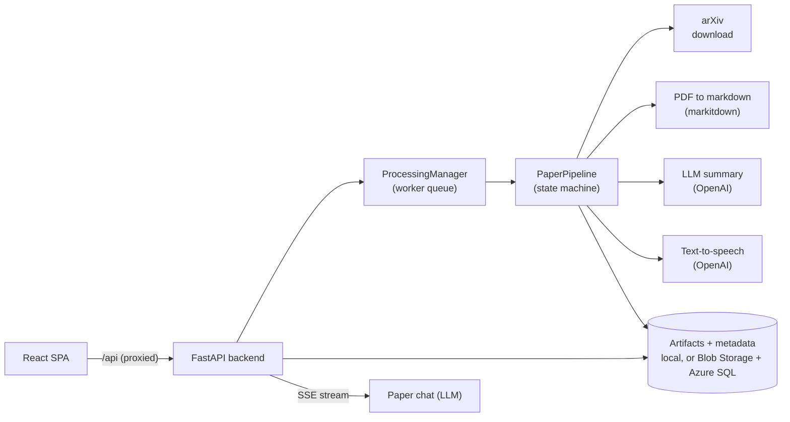

# Paper Podcasts

Turn arXiv papers into rich summaries and listenable audio, then chat with the papers in your library.

Private deployment behind authentication, not publicly accessible.

<!-- screenshot -->

## What it does

- Search arXiv and queue one or several papers for processing.
- Watch each job move through download, text extraction, summary and audio generation, with live stage and progress updates.
- Browse a library of processed papers, filtered by processing status and by listened or unlistened.
- Read an audio-friendly summary for each paper, rendered in the app. The full paper opens on arXiv.
- Play the generated audio and mark papers as listened.
- Chat with one or more papers from the library; answers stream in and are grounded in the extracted paper text.

## How it works

A shared pipeline in `src/` takes each paper through four stages. A state machine
(`python-statemachine`) guards every transition, so a stage never runs twice and a
failed or interrupted job resumes from the last saved stage. A background
`ProcessingManager` runs several jobs concurrently and queues the overflow.

Every service sits behind a provider interface (LLM, text-to-speech), and storage sits
behind an artifact store and a metadata store. Locally these are the filesystem and
SQLite, with no cloud setup. In production they are Azure Blob Storage and Azure SQL.

The browser only ever talks to the web server that serves the React app, which proxies
`/api` to the backend. In production the backend has no public ingress.

## Tech stack

- **Python 3.13, FastAPI, uvicorn**: API, job queue and chat streaming (server-sent events).
- **python-statemachine**: the paper-processing state machine.
- **OpenAI API**: paper summaries, paper chat and text-to-speech audio.
- **markitdown**: PDF to markdown extraction.
- **React, TypeScript, Vite, Tailwind CSS**: the web UI.
- **SQLite and the local filesystem / Azure SQL and Blob Storage**: storage, chosen with `STORAGE_BACKEND`.
- **Azure Container Apps, Bicep, Entra Easy Auth**: hosting, infrastructure as code and sign-in.
- **pytest, ruff, pyright, vitest, GitHub Actions**: tests, lint, type checking and CI.

## Repository layout

- `src/`: shared domain models, services and pipeline
- `backend/`: FastAPI API server
- `frontend/`: React UI
- `prompts/`: LLM prompt templates
- `infra/`, `scripts/`: Azure infrastructure and deploy scripts

## More

- [Run it locally and run the checks](docs/development.md)
- [Deployment](deployment/README.md)
